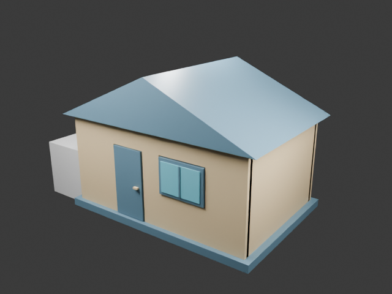
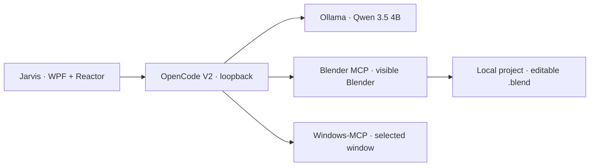

<p align="center"></p>

# Jarvis_X

**A local AI workspace for Windows.** Chat with Qwen, build projects through OpenCode, create editable Blender scenes from reference images, and inspect or operate a selected Windows app. The Reactor shows model timing and live system readings while the run is in progress.

| Workspace | What you can do |
| --- | --- |
| Chat | Ask questions and attach a reference image |
| Blender | Build a scene, compare viewport captures, refine the result, and save an editable `.blend` |
| Desktop | Select a window, inspect it, and approve clicks or typing |
| Plan / Build | Inspect a Git project, review changes, and approve terminal commands |



*Example house rendered locally in Blender. The structured house tool creates editable geometry and procedural materials.*

## How it fits together



## Reproduce the setup on Windows

1. Install [Git for Windows](https://git-scm.com/download/win), [PowerShell 7](https://learn.microsoft.com/powershell/scripting/install/installing-powershell-on-windows), the [.NET 10 SDK](https://dotnet.microsoft.com/download/dotnet/10.0), the [WebView2 Evergreen Runtime](https://developer.microsoft.com/microsoft-edge/webview2/), [Node.js](https://nodejs.org/), [uv](https://docs.astral.sh/uv/getting-started/installation/), [Ollama for Windows](https://ollama.com/download/windows), and [Blender](https://www.blender.org/download/). Blender 5.2 was used for the original setup.
2. Clone the repository and install the pinned OpenCode V2 CLI in a user-local directory. [OpenCode installation](https://opencode.ai/docs/)

   ```powershell
   git clone https://github.com/amilapcsgit/Jarvis_X.git
   cd Jarvis_X

   $openCodeRoot = Join-Path $env:LOCALAPPDATA 'JarvisRuntimes\OpenCode'
   npm install --prefix $openCodeRoot @opencode/cli@2.4.1
   $openCodeExe = Join-Path $openCodeRoot 'node_modules\@opencode\cli\bin\opencode.exe'
   if (!(Test-Path -LiteralPath $openCodeExe)) { throw 'OpenCode executable missing' }
   [Environment]::SetEnvironmentVariable('JARVIS_OPENCODE', $openCodeExe, 'User')
   $env:JARVIS_OPENCODE = $openCodeExe
   ```

3. Start Ollama from the Start menu, then pull the local vision model and create Jarvis’s 8K-context tag. [Qwen 3.5 4B on Ollama](https://ollama.com/library/qwen3.5:4b)

   ```powershell
   ollama pull qwen3.5:4b
   ollama create qwen3.5-pilot:4b -f .\Modelfile.Qwen
   ```

4. If Blender is installed elsewhere, set `JARVIS_BLENDER` to the full path to `blender.exe` in your Windows user environment. Prepare the pinned MCP packages and publish Jarvis from PowerShell 7.

   ```powershell
   .\Setup-Jarvis.ps1 -DownloadDependencies
   .\publish-v2\Jarvis.exe
   ```

   The first setup needs internet for tools, packages, and model weights. Subsequent setup can use the installed cache by omitting `-DownloadDependencies`. Keep the `web` and `runtime` folders and Python files next to the executable. To create a desktop shortcut after verification, run `.\Setup-Jarvis.ps1 -PromoteShortcut`.

### First Blender run

1. Open a disposable project folder, select **Blender**, and attach an image if you have a reference.
2. Try *Create a two-story house with French windows and one entrance. Save an editable Blender file.*
3. Review the operation and approve it. The **Preview** area displays captures, and **Operations** shows the script, outcome, and any errors. For custom models, answer design questions in the same conversation so Jarvis can continue from the current scene.

**Allow Blender Python for this session** also covers revised scripts and previews in the selected project. Blender Python runs with your Windows account permissions. **Revoke**, changing projects, **Emergency Stop**, and closing Jarvis clear the session grant. Use **Ctrl+Shift+F12** for Emergency Stop when the app registers that shortcut.

### Optional Inkling model

Qwen is the default and needs only Ollama. To use Inkling, install a compatible Windows llama.cpp build and the [Inkling GGUF and vision projector](https://huggingface.co/unsloth/Inkling-2-Mini-GGUF). Set the Windows user variables `JARVIS_LLAMA_SERVER`, `JARVIS_INKLING_MODEL`, and `JARVIS_INKLING_PROJECTOR` to the full paths. Select **Inkling** in Jarvis when ready.

### Troubleshooting

| Symptom | Check |
| --- | --- |
| Qwen tag missing | Run `ollama list` and create `qwen3.5-pilot:4b` with the included Modelfile |
| OpenCode fails to start | Verify `JARVIS_OPENCODE` points to the V2 executable. Restart Jarvis after changing the environment |
| Blender connector unavailable | Check `JARVIS_BLENDER`, then rerun setup and inspect **Runtime output** |
| A tool fails after approval | Open the action in **Operations** and inspect the execution error |
| Desktop target changes | Refocus the selected window and request a fresh snapshot before more input |

OpenCode history and logs live under `%LOCALAPPDATA%\Jarvis`. The repository contains app source, setup files, Reactor assets, and a demo render. Bundled font and Three.js notices are in [web/licenses](web/licenses).
