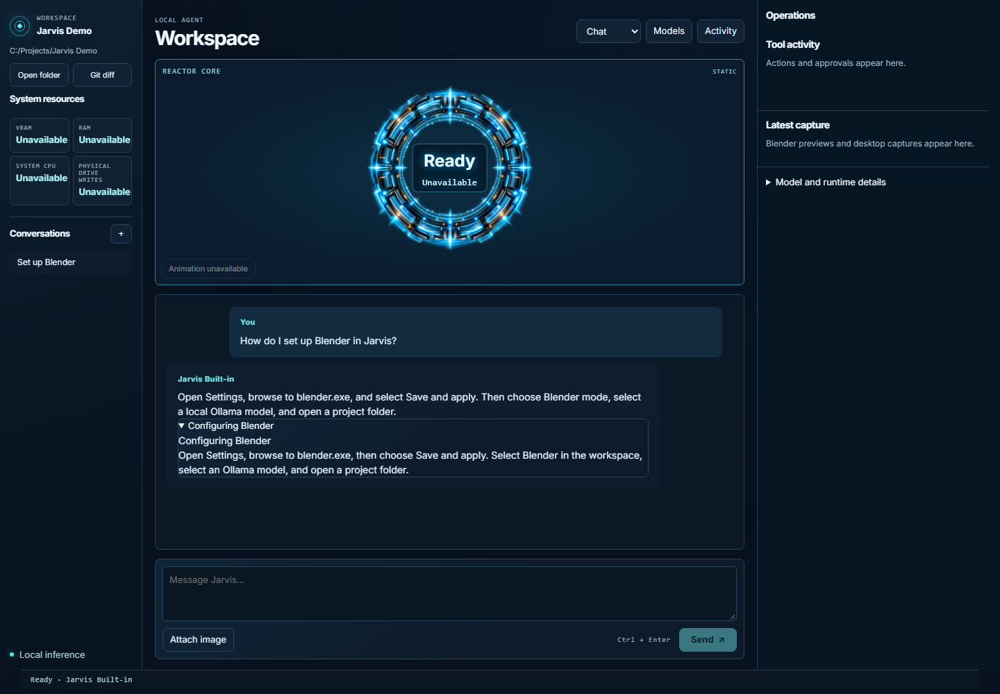
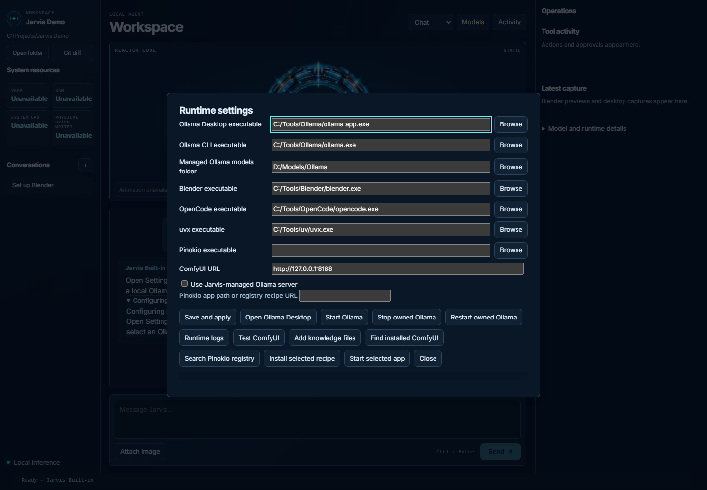

# Jarvis_X

**A local AI workspace for Windows x64.** Start with bundled Gemma chat and searchable Jarvis Help. Add local task models when you want to build projects, model in Blender, or operate a selected Windows app.

[Windows releases](https://github.com/amilapcsgit/Jarvis_X/releases/latest) · [License](LICENSE) · [Bundled model notices](builtin/MODELS.md)

## Inside Jarvis



*Built-in Chat with an expanded Jarvis Help source. The screenshot uses a demo conversation.*



*Runtime Settings with example paths for Ollama, Blender, and optional connectors.*

## Install and start chatting

1. Choose a release whose notes list **Built-in Gemma** and the **Nullsoft installer**. Download **Jarvis_X_Setup.exe** and its checksum from that release. The earlier v1.0.0 installer predates this setup.
2. Run the Nullsoft wizard. Choose an installation folder and whether to create a desktop shortcut.
3. Open **Jarvis_X**, choose **Chat**, and ask *How do I set up Blender?* Expand the source card to read the matching passage.

Built-in chat uses the bundled CPU runtime and weights. **Settings → Add knowledge files** imports text and Markdown into the local knowledge library.

## Add task tools

Open **Settings** to inspect or change dependency paths. The setup wizard reports common installed tools. If you need additional dependencies, run **Install-Missing-Dependencies.bat** from the install folder or download it from the same release. The helper checks for working installations and prompts before installing packages. Its saved-path check uses Windows PowerShell to read JSON.

| Mode | What to try |
| --- | --- |
| Chat | Ask about Jarvis or search imported text and Markdown. |
| Blender | Select a local Ollama model and ask for an editable scene. Auto can start the Python fallback when the model lacks native tools. |
| Desktop | Select a disposable window, approve the chat, and verify actions in that window. |
| Plan / Build | Select a project and inspect its changes or run its build and tests through OpenCode. |

In **Models**, use **Open Ollama Desktop**, then **Refresh**. In chat, commands such as **list models** and **select model qwen3.5:4b** provide another route to the same controls. Jarvis requests confirmation before model selection or download from chat.

### Example Blender output


*Example scene with editable geometry and procedural materials.*

## Approvals and troubleshooting

- **Allow this chat** scopes approval to the current mode and project. Desktop also binds approval to the selected window.
- **Emergency Stop** terminates Jarvis-owned workers and revokes approvals. Save work in Jarvis-started Blender before stopping when possible.
- If models are missing, check Ollama startup and the selected model directory. A shared Ollama process uses its own settings.
- For ComfyUI, use **Test ComfyUI** with an existing local or LAN endpoint. Pinokio-managed discovery and launch require a reachable Pinokio control plane.

## Build from source

Use the .NET 10 SDK, Node.js, Python and NSIS on Windows x64. Run the pinned asset preparation and installer build in PowerShell.

```powershell
./Get-ReleaseAssets.ps1
dotnet restore Jarvis.csproj -r win-x64
./Build-Nullsoft.ps1
```

GitHub Actions validates Windows builds and prepares installer assets on version tags. Check the release notes for the smoke-test results.

## License

Author **L.J. Amila Prasad Perera**. Jarvis-owned material is available for personal, non-commercial use under the [Jarvis_X license](LICENSE). Bundled models, runtimes, fonts and other dependencies retain their own terms. See [model notices](builtin/MODELS.md) and [web asset notices](web/licenses).
