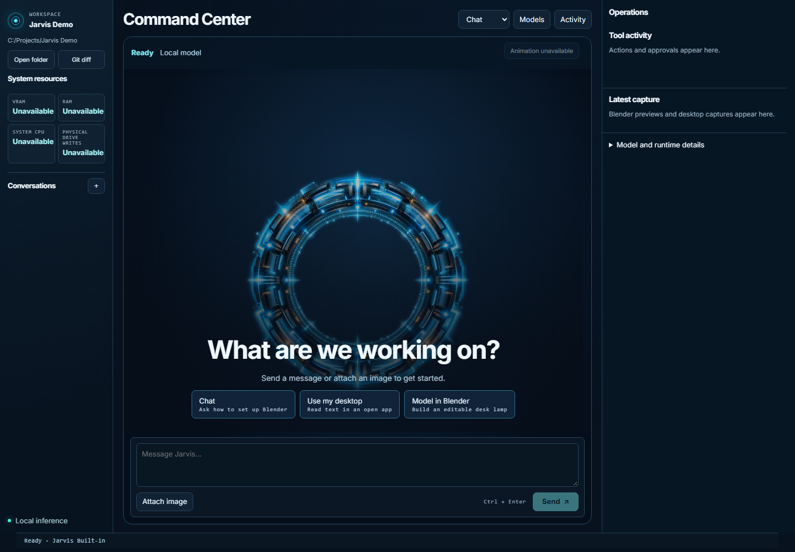
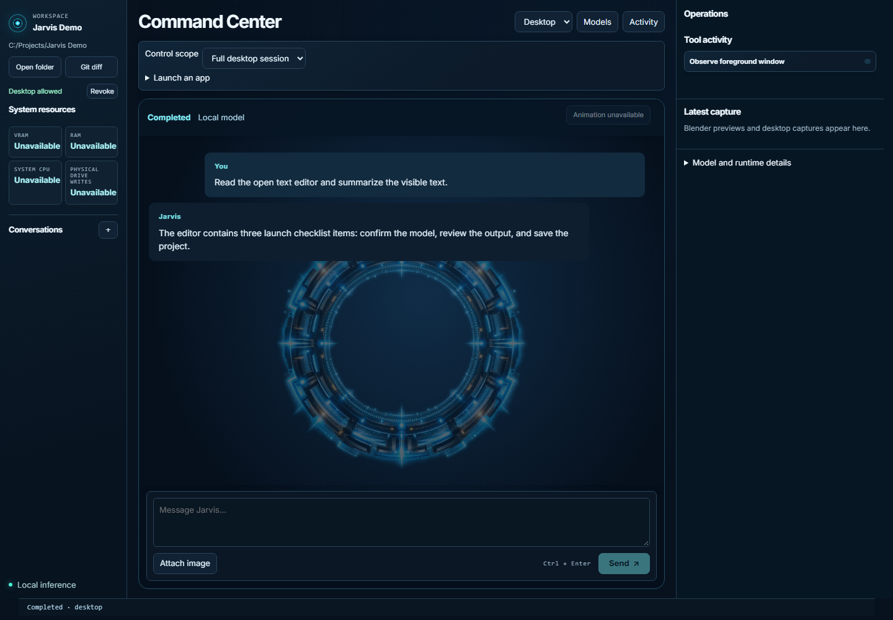
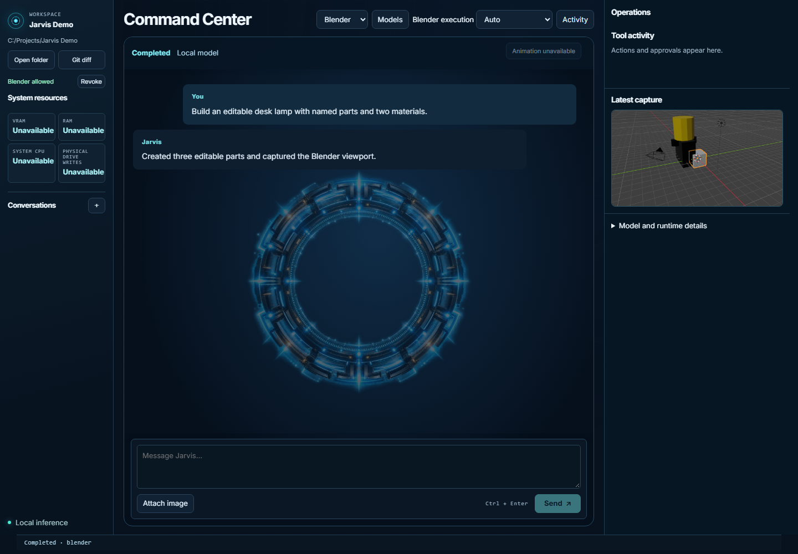

<p align="center"></p>

# Jarvis_X

**A local AI command center for Windows x64.** Chat with bundled Gemma, work across Windows apps with a local Ollama model, or build editable scenes in Blender.

[**Download the Windows installer**](https://github.com/amilapcsgit/Jarvis_X/releases/latest/download/Jarvis_X_Setup.exe) · [Release notes and SHA-256](https://github.com/amilapcsgit/Jarvis_X/releases/latest) · [Get optional task dependencies](https://github.com/amilapcsgit/Jarvis_X/releases/latest/download/Install-Missing-Dependencies.bat)



*The Command Center keeps the Reactor, composer, and Operations in one workspace. Screenshots use a disposable demo project.*

## Choose a workflow

| Mode | What you can do |
| --- | --- |
| **Chat** | Start with bundled Gemma, ask about Jarvis, or add text and Markdown files for local retrieval. |
| **Desktop** | Choose **Full desktop session** for app switching or **Single window** for a narrower scope. Jarvis observes the current window before acting and records results in Operations. Vision models can use screenshots. |
| **Blender** | Use **Auto** for structured editable parts, **Native tools** for direct Blender tools, or **Python fallback** when you need a script-based workflow. |
| **Plan / Build** | Select a local project to inspect Git changes, run supported tests, and work through changes in OpenCode. |

### Desktop control



The Desktop planner uses the selected local Ollama model. **Take control** pauses input. **Emergency Stop** terminates Jarvis-owned workers and revokes approvals. The demo transcript illustrates the interface.

### Editable Blender models



Ask for named parts, dimensions, and materials. Jarvis can update parts in a dedicated collection and verify a saved project-local `.blend` file. The screenshot includes a viewport captured during a local modeling check.

## Install and start chatting

1. Download **Jarvis_X_Setup.exe** and the SHA-256 checksum from the GitHub release.
2. Run the Nullsoft wizard and choose the installation folder.
3. Open **Jarvis_X** and use the composer or pick a starter prompt. Built-in chat runs with the bundled CPU runtime and model weights.
4. For task tools, open **Settings** or run **Install-Missing-Dependencies.bat**. The helper detects existing tools and prompts before installing missing packages. Choose your local task model in **Models**.

[](docs/screenshots/settings.png)

*Runtime Settings uses example paths. For ComfyUI, test an existing endpoint or use the Pinokio controls with a reachable Pinokio installation.*

## Build from source

Use Windows x64, the .NET 10 SDK, Node.js, Python, and NSIS. For the full installer, fetch the pinned model and runtime assets first.

```powershell
./Get-ReleaseAssets.ps1
dotnet restore Jarvis.csproj -r win-x64
./Build-Nullsoft.ps1
```

GitHub Actions validates the Windows build. Release notes describe the checks run for each installer.

## License

Author **L.J. Amila Prasad Perera**. Jarvis-owned material is licensed for personal, non-commercial use. Bundled components retain their own terms. [Jarvis_X license](LICENSE) · [Model provenance](builtin/MODELS.md) · [Third-party notices](licenses)
